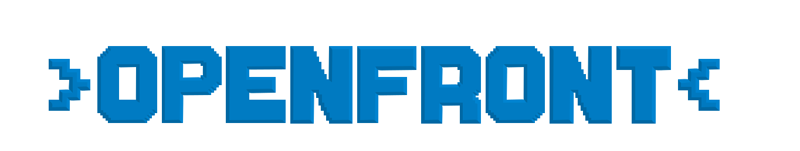

<p align="center">
  <picture>
    <source media="(prefers-color-scheme: dark)" srcset="proprietary/images/OpenFrontLogoDark.svg">
    <source media="(prefers-color-scheme: light)" srcset="proprietary/images/OpenFrontLogo.svg">
    
  </picture>
</p>

[Zombie Defense](https://zombie-defense.io/) is an online real-time strategy game focused on territorial control and alliance building. Players compete to expand their territory, build structures, and form strategic alliances in various maps based on real-world geography.

<!-- Propuesta (O2/D1): dominio provisional https://zombie-defense.io/ —
     sustituir por el dominio definitivo cuando exista (no inventar). -->

This is a fork/rewrite of WarFront.io. Credit to https://github.com/WarFrontIO.


[](https://crowdin.com/project/openfront-mls)
[](https://cla-assistant.io/openfrontio/OpenFrontIO)
[](https://www.gnu.org/licenses/agpl-3.0)
[](https://creativecommons.org/licenses/by-sa/4.0/)

<!-- Propuesta (O2/D1): los badges de CI/Crowdin/CLA y el clonado de abajo
     siguen apuntando al upstream openfrontio/OpenFrontIO; pendiente de que el
     coordinador fije repo/org/proyecto nuevos (no inventar URLs). -->

## License

OpenFront source code is licensed under the **GNU Affero General Public License v3.0**

Current copyright notices appear in:

<!-- MARKER (O4/D2): notices de copyright retiradas temporalmente para el
     sandbox no comercial (sign-off D2 + D3). Footer y loading screen ya no
     muestran el copyright upstream: el footer perdió su span de copyright
     (Footer.ts) y la clave main.copyright se neutralizó en
     resources/lang/en.json. Texto previo exacto y tabla de retiradas:
     docs/LEGAL-SANDBOX.md. Re-add por branch de miembro:
       git checkout 7160185 -- README.md -->

- Notices retiradas temporalmente (O4/D2): footer y loading screen.

See the [LICENSE](LICENSE) for complete requirements.

For asset licensing, see [LICENSE-ASSETS](LICENSE-ASSETS).  
For license history, see [LICENSING.md](LICENSING.md).

## 🌟 Features

- **Real-time Strategy Gameplay**: Expand your territory and engage in strategic battles
- **Alliance System**: Form alliances with other players for mutual defense
- **Multiple Maps**: Play across various geographical regions including Europe, Asia, Africa, and more
- **Resource Management**: Balance your expansion with defensive capabilities
- **Cross-platform**: Play in any modern web browser

## 📋 Prerequisites

- [Node.js](https://nodejs.org/) v24.15.0 or newer in the Node 24 release line
- [npm](https://www.npmjs.com/) v12.1.0 or newer in the npm 12 release line
- A modern web browser (Chrome, Firefox, Edge, etc.)

Node.js may bundle an older npm version. Upgrade it before installing project dependencies:

```bash
npm install --global --ignore-scripts npm@12.1.0
```

## 🚀 Installation

1. **Clone the repository**

   ```bash
   git clone https://github.com/openfrontio/OpenFrontIO.git
   cd OpenFrontIO
   ```

2. **Install dependencies**

   ```bash
   npm run inst
   ```

   Do NOT use `npm install` nor `npm i` for project dependencies. Use `npm run inst`; it runs the safer `npm ci --ignore-scripts` to install exactly the versions in `package-lock.json` without running lifecycle scripts.

   The repository also rejects dependency releases less than seven days old and dependencies sourced from Git, remote URLs, local tarballs, or directories. Wait until a new release passes the seven-day window before updating it; security exceptions require explicit maintainer review.

## 🎮 Running the Game

### Development Mode

Run both the client and server in development mode with live reloading:

```bash
npm run dev
```

This will:

- Start the webpack dev server for the client
- Launch the game server with development settings
- Open the game in your default browser (to disable this behavior, set `SKIP_BROWSER_OPEN=true` in your environment)

### Easiest on Windows (double-click)

On Windows, double-click `Iniciar-Juego.cmd` in the repo root, or run:

```powershell
npm run dev:simple
```

It checks the Node/npm versions, installs dependencies with `npm run inst` if `node_modules` is missing, verifies the dev ports are free, then starts `npm run dev` and opens `http://localhost:9000/` in your browser. To skip opening the browser: `$env:SKIP_BROWSER_OPEN="true"; npm run dev:simple`.

### Client Only

To run just the client with hot reloading:

```bash
npm run start:client
```

### Server Only

To run just the server with development settings:

```bash
npm run start:server-dev
```

### Connecting to staging or production backends

Sometimes it's useful to connect to production servers when replaying a game, testing user profiles, purchases, or login flow.

> To replay a production game, make sure you're on the same commit that the game you want to replay was executed on, you can find the `gitCommit` value via `https://api.openfront.io/game/[gameId]`.
> Unfinished games cannot be replayed on localhost.

To connect to staging api servers:

```bash
npm run dev:staging
```

To connect to production api servers:

```bash
npm run dev:prod
```

## 🛠️ Development Tools

- **Format code**:

  ```bash
  npm run format
  ```

- **Lint code with Oxlint and ESLint**:

  ```bash
  npm run lint
  ```

- **Lint and fix code with Oxlint and ESLint**:

  ```bash
  npm run lint:fix
  ```

- **Testing**
  ```bash
  npm test
  ```

## 🏗️ Project Structure

- `/src/client` - Frontend game client
- `/src/server` - Backend game server
- `/packages/engine` - Deterministic game simulation (`@zombie-defense/engine`)
- `/packages/engine-api` - The engine's contract: types, schemas, game updates and the worker protocol (`@zombie-defense/engine-api`)
- `/packages/engine-lib` - Engine code also used outside the engine: map grid, rules, helpers (`@zombie-defense/engine-lib`)
- `/packages/shared` - Code shared by client and server: wire schemas, env, asset URLs (`@zombie-defense/shared`)
- `/packages/zbin` - Compact binary wire format for zod schemas (self-contained, zod-only)
- `/resources` - Static assets (images, maps, etc.)

## 🤝 Contributing

Contributions and translations are welcome! See [CONTRIBUTING.md](CONTRIBUTING.md) for the workflow, the approved-issue process, project governance, and translation info.
